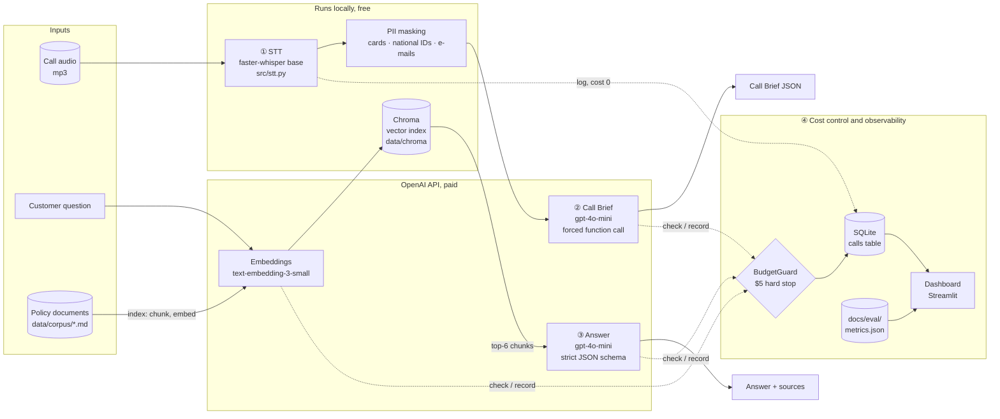
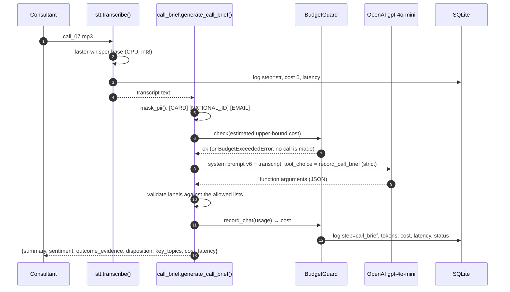
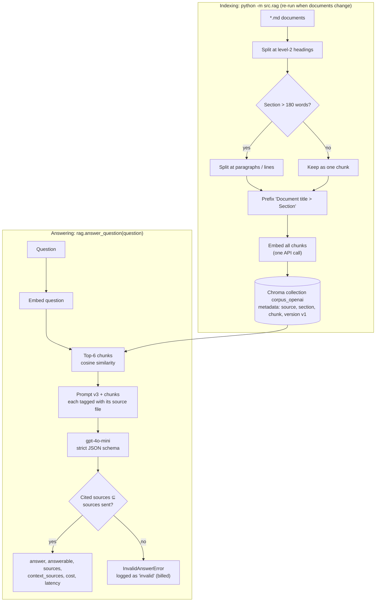
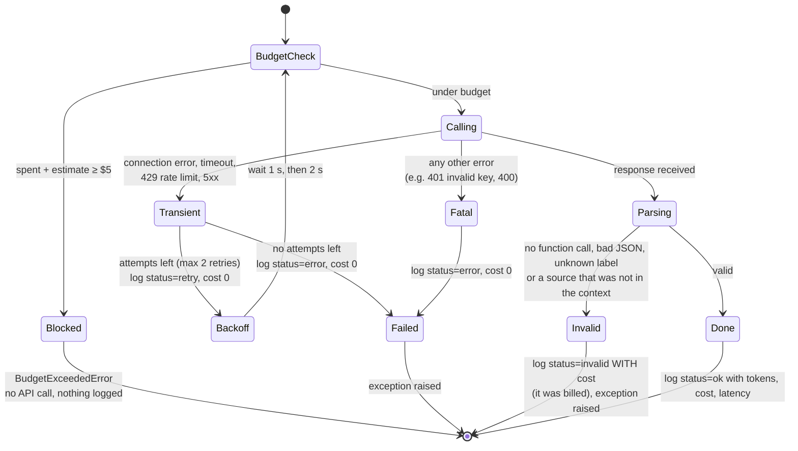
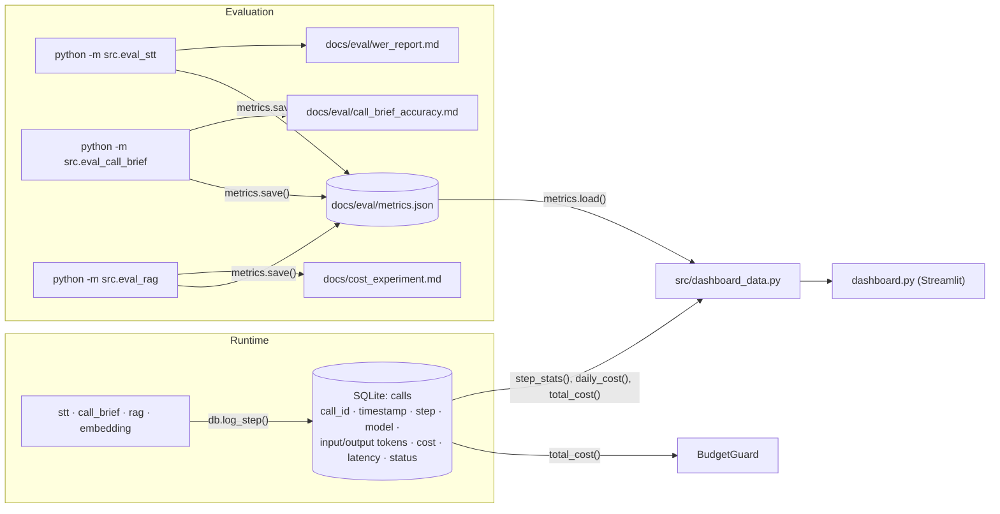

# ClientPulse

**Post-call intelligence for one-person service businesses.** ClientPulse turns a recorded customer
call into a transcript and a structured *Call Brief* (summary, customer sentiment, call outcome), and
answers customer questions from the consultant's own documents with retrieval-augmented generation
(*Ask My Docs*). Every paid model call is budget-checked, logged and visible on a cost & metrics dashboard.

> ClientPulse is a personal post-call intelligence tool for independent consultants and small service
> businesses. It was built from scratch to learn speech-to-text, summarisation and RAG, using OpenAI
> Whisper models, gpt-4o-mini and text-embedding-3-small. Unlike enterprise contact-centre software
> (ACD / IVR / dialers), it focuses on a single user: intelligence after the call, plus question answering
> over the user's own documents. Claude Code was used as the development tool; the product's runtime
> uses only the OpenAI API (and local open-source models).

All data in this repository is **synthetic**: a fictional consultancy ("Ward Advisory"), 21 scripted calls
turned into audio with text-to-speech, and 6 hand-written policy documents. No real customer data was used.

---

## Contents

1. [The business problem](#1-the-business-problem)
2. [What it does](#2-what-it-does)
3. [Results at a glance](#3-results-at-a-glance)
4. [Architecture](#4-architecture)
5. [Runtime rules: how the system behaves](#5-runtime-rules-how-the-system-behaves)
6. [Decisions and what we changed on the way](#6-decisions-and-what-we-changed-on-the-way)
7. [How quality is measured](#7-how-quality-is-measured)
8. [Getting started](#8-getting-started)
9. [Working on the code](#9-working-on-the-code)
10. [Repository layout](#10-repository-layout)
11. [Known limitations and backlog](#11-known-limitations-and-backlog)

---

## 1. The business problem

An independent consultant, coach or accountant has no CRM team and no assistant. After every call they
write their own notes, remember who is still "thinking about it", and answer the same questions again and
again: *How much is a session? What if I cancel tomorrow? When do I get my action plan?*

| Pain | What ClientPulse does about it | Business effect |
|---|---|---|
| Notes after every call take time and are inconsistent | Automatic transcript + 2–3 sentence summary + key topics | Minutes saved per call; searchable history |
| Pending sales are forgotten | Every call gets an **outcome label** (e.g. `prospect_considering` = follow-up needed) | No lost follow-ups, a simple sales pipeline |
| Unhappy customers are noticed too late | **Sentiment** of the customer across the call | Early warning on at-risk clients |
| Repeated questions about prices, refunds, process | **Ask My Docs**: answers grounded only in the consultant's documents, with sources | Consistent, policy-correct answers; no invented rules |
| AI cost is unpredictable | Hard budget stop, per-step cost log, dashboard | Spend is known per call and capped |

**Unit economics (measured).** One call with the default setup costs about **$0.0004**: local
transcription is free, a Call Brief costs ~$0.0002 and one Ask My Docs question ~$0.0002. 1,000 calls per
month ≈ **$0.40** in model fees. RAG sends ~1,070 instead of ~4,440 prompt tokens per question, a **72% lower
cost per question** than putting all documents into every prompt, at equal or better accuracy.

---

## 2. What it does

| Capability | Input | Output | Engine |
|---|---|---|---|
| **Transcription** | Call audio (mp3) | Full text + timed segments | faster-whisper `base`, local, CPU int8 |
| **Call Brief** | Transcript | `{summary, sentiment, outcome_evidence, disposition, key_topics}` | gpt-4o-mini, one forced function call |
| **Ask My Docs** | A question | `{answer, answerable, sources}` | text-embedding-3-small + Chroma (top-6) + gpt-4o-mini |
| **Cost control** | Every paid call | Hard stop at $5, warning at 80% | BudgetGuard + SQLite |
| **Dashboard** | SQLite log + eval metrics | Budget, cost per call, quality vs targets, spend charts | Streamlit (read-only) |

**Call outcomes (`disposition`)** — exactly one per call:

| Label | Meaning | Typical follow-up |
|---|---|---|
| `offer_accepted` | Customer agrees to pay for a new or upgraded service | Send agreement / invoice |
| `prospect_considering` | Interested, postpones the decision (incl. "send me an overview") | Follow up |
| `offer_declined` | A prospect declines or asks not to be contacted | Remove from follow-up list |
| `customer_cancelled` | An existing client stops a service they bought | Process cancellation / refund |
| `complaint_resolved` | A complaint was raised and fixed during the call | Check satisfaction later |
| `customer_inquiry` | Questions, invoices, rescheduling; no purchase decision pending | None |

**Sentiment** is the *customer's* attitude across the whole call: `positive`, `neutral` or `negative`.

---

## 3. Results at a glance

Measured on synthetic data; details in `docs/`. "Held-out" means questions or calls that were not used to
tune the prompts.

| Metric | Target | Measured | Status | Report |
|---|---|---|---|---|
| STT word error rate (WER) | < 15% | **1.2%** (base, normalised) | ✅ met | `docs/eval/wer_report.md` |
| Call Brief disposition accuracy | ≥ 85% | **75%** held-out (100% on tuning set) | ❌ missed | `docs/eval/call_brief_accuracy.md` |
| Call Brief sentiment accuracy | ≥ 85% | **67%** held-out | ❌ missed | same |
| Ask My Docs answer accuracy | — | **30/32** overall, 11/12 held-out | reported | `docs/cost_experiment.md` |
| RAG context recall | reported | **24/25** questions with all facts in the top-6 chunks | reported | same |
| RAG faithfulness | ≥ 90% | not judged separately yet | ⚪ open | — |
| Cost per call | reported | **$0.00038** | reported | dashboard |
| End-to-end latency | reported | **~19 s** (STT 16 s on CPU + Brief 1.7 s + RAG 1.5 s) | reported | dashboard |

Total OpenAI spend for the whole project, including all experiments: **≈ $0.16**.

---

## 4. Architecture

### 4.1 System overview



Design principles behind the picture:

- **One runtime provider.** Only the OpenAI API is called at runtime; everything else is local and free
  (faster-whisper, Chroma, SQLite).
- **Privacy before the network.** A transcript is PII-masked *before* it leaves the machine.
- **Every paid call has the same envelope:** budget check → call → record cost → log status
  (§5.1). New paid steps must follow it.
- **Batch, not real time.** Calls are processed after they end. Latency is measured but not budgeted
  (a live assistant would need streaming and a strict latency budget; that is out of scope).
- **Measure, then change.** Every model, prompt or retrieval decision is backed by an eval script and a
  report in `docs/`.

### 4.2 Call Brief pipeline



### 4.3 Ask My Docs (RAG) pipeline



`answer_question(..., use_rag=False)` skips retrieval and sends the whole corpus instead. That is the
baseline of the RAG vs no-RAG cost experiment, not a production mode.

### 4.4 Lifecycle of a paid model call

Call Brief and Ask My Docs share this state machine (`src/call_brief.py`, `src/rag.py`):



### 4.5 Spend and metrics data flow



---

## 5. Runtime rules: how the system behaves

### 5.1 Cost and budget

| When… | …then |
|---|---|
| Any paid call is about to start | `BudgetGuard.check()` estimates an **upper bound** (≈ 4 characters per token + max output tokens). If spend + estimate ≥ **$5.00**, `BudgetExceededError` is raised and **no request is sent**. |
| A paid call succeeds | Cost = tokens × price table in `src/budget_guard.py`, written to SQLite. |
| Total spend passes **80%** of the budget | A warning is printed on every further paid call. |
| The process restarts | Nothing is lost: spend is the sum of the `cost` column in SQLite, not a counter in memory. |
| A request fails before a response | Logged with **cost 0** (`retry` or `error`). Failed calls are never charged. |
| A response arrives but is unusable | Logged as `invalid` **with its cost**, because OpenAI billed it. |
| Local STT runs | Logged as `stt` with cost 0, so latency is still tracked. |

The OpenAI account budget only sends e-mails; it does not stop requests. BudgetGuard is the actual hard
stop. Prices in `PRICE` must be updated by hand when OpenAI changes them.

### 5.2 Errors and retries

| Error | Behaviour |
|---|---|
| Connection error, timeout, HTTP 429, HTTP 5xx | Retried **2 times** with backoff 1 s → 2 s. Each failed attempt logged as `retry`, the last as `error`. The budget is checked again before each attempt. |
| Any other API error (401 expired key, 400 bad request) | Logged as `error`, raised immediately, no retry. |
| Model returns no function call / invalid JSON / a label outside the list | `InvalidBriefError` |
| Model cites a document it was not given | `InvalidAnswerError` |

The OpenAI SDK's own retries are switched off (`OpenAI(max_retries=0)`) so that every attempt is visible in
the log.

### 5.3 Privacy

| When… | …then |
|---|---|
| A transcript goes to the Call Brief model | `mask_pii()` first replaces card numbers (13–19 digits, spaces/dashes allowed) with `[CARD]`, 11-digit national IDs with `[NATIONAL_ID]`, e-mail addresses with `[EMAIL]`. |
| Audio is transcribed | Locally; audio never leaves the machine. |
| The corpus is indexed | Document text is sent to the embedding API (it is the consultant's own public policy text). |
| A customer question is answered | ⚠️ The question is **not** masked yet (see §11). |

### 5.4 Call Brief rules (prompt v6)

| Situation | Rule |
|---|---|
| Choosing the outcome | The model first writes `outcome_evidence` (what the customer decided, did money change hands), then picks the label. Rules are checked **in order** and the first that applies wins: `complaint_resolved` → `customer_cancelled` → `offer_declined` → `offer_accepted` → `prospect_considering` → `customer_inquiry`. |
| A complaint is fixed with a free extra session | Still `complaint_resolved`, not a purchase. |
| A prospect wants an overview by email before deciding | `prospect_considering` (a follow-up is expected). |
| An existing client only moves an appointment | `customer_inquiry`. |
| The customer is polite ("thank you, good luck") | Politeness is **not** positive sentiment. |
| The call starts with a problem and ends calmly | `neutral`. |
| The customer stays unconvinced, e.g. about price | `negative`. |
| Any field is missing or a label is unknown | Rejected by the strict schema or by validation (§5.2). |

Output limits: `temperature=0`, max 400 output tokens. The transcript has no speaker labels (no diarization).

### 5.5 Ask My Docs rules (prompt v3)

| Situation | Behaviour |
|---|---|
| The documents answer the question | 1–4 sentences with the exact figures, deadlines and conditions; `answerable: true`; `sources` = files used. |
| The documents **explicitly** say no ("no discounts", "cash is not accepted") | Answer "No" with the rule; `answerable: true`. |
| The documents say **nothing** about it | Exactly *"The documents do not contain this information."*, `answerable: false`, `sources: []`. A missing mention is never turned into a "no". |
| The question needs a calculation (refund, fee) | Every step is written with its intermediate result, e.g. `3 x $158 = $474; $474 - $50 = $424`. |
| The question is about a process or timeline | Every step from the documents is listed. |
| The model cites a file that was not in the context | Rejected (`InvalidAnswerError`). |
| Retrieval settings | Top-**6** chunks, cosine similarity, `temperature=0`, max 300 output tokens. |

### 5.6 Index rules

| When… | …then |
|---|---|
| A document in `data/corpus/` is added or changed | Re-run `python -m src.rag`. The collection is **emptied and rebuilt**, so there are no stale or duplicate chunks. Cost ≈ $0.0001. |
| The corpus changes in meaning | Bump `CORPUS_VERSION` in `src/rag.py` (stored on every chunk). |
| A different embedding is used | Each embedding has its own Chroma collection (`corpus_openai`, `corpus_minilm`); they never mix. |
| A section is longer than 180 words | It is split at paragraph, then line boundaries; each piece keeps the `Title > Section` prefix. |

### 5.7 Evaluation rules

| Rule | Why |
|---|---|
| Every prompt change bumps `PROMPT_VERSION` | Results and caches are kept per version and stay comparable. |
| Eval outputs are cached (`data/synthetic_calls/briefs/<version>/`, `data/rag_answers/<version>/`) | Re-running a report costs nothing; `--force` asks the model again. |
| Golden data has a `dev` and a `test` split | Prompts are tuned on `dev` only. `test` items are written **before** a prompt change and committed first, so git history proves they were unseen. |
| Once a test set has been used to make a decision, it is "seen" | The next prompt change needs fresh held-out items. |

---

## 6. Decisions and what we changed on the way

| # | Area | Planned | What we did | Why (evidence) |
|---|---|---|---|---|
| 1 | STT engine | Local or OpenAI API | **Local faster-whisper `base`** | On the same call the API had the same WER (1.7%) as local `base` but costs $3–6 per 1,000 minutes. `base` is the balance: 1.2% WER vs 0.9% for `small` at half the time. (`docs/eval/stt_api_vs_local.md`, `wer_report.md`) |
| 2 | Diarization | WhisperX | **Deferred** | WhisperX needs torch, a Hugging Face token and pyannote licences; heavy on an 8 GB laptop. Ground truth for later is ready (`audio/*.segments.json`). |
| 3 | Call Brief calls | 3 calls (summary, sentiment, outcome) | **One forced, strict function call** | One request is cheaper and the schema guarantees parseable output. |
| 4 | Outcome accuracy | Labels + definitions | **`outcome_evidence` sentence before the label, ordered rules** | Disposition on the tuning set rose from 67% to 89% (prompt v1 → v3). |
| 5 | Model | gpt-4o-mini | **Kept gpt-4o-mini** | gpt-4o was 17× more expensive for one more correct sentiment label on 9 calls. |
| 6 | Labels | Turkish ASCII labels | **Self-describing English labels** | The label `red` (Turkish for "declined") was never predicted: in an English prompt it reads as a colour. Readable names also help any reviewer. |
| 7 | Evaluation | One labelled set | **dev/test split, held-out sets** | 100% on dev vs 75% on new calls showed prompt overfitting. Only held-out numbers are reported as real performance. |
| 8 | Embeddings | sentence-transformers (local) | **Chroma's built-in ONNX MiniLM first, then OpenAI `text-embedding-3-small`** | MiniLM needs no torch install. Measured on the golden set: all key facts in the top-6 for 16/16 questions with OpenAI vs 15/16 with MiniLM (MiniLM missed the "Discounts" section). Indexing the corpus costs $0.0001. MiniLM is kept for offline tests. |
| 9 | Chunk size | ~400 tokens | **~180 words (~250 tokens), split by section** | MiniLM truncates after 256 tokens. Both embeddings use the same chunks so the comparison is fair. |
| 10 | Top-k | 4 | **6** | Context recall 14/16 at top-4 vs 16/16 at top-6; prompt still 76% smaller than the full corpus. |
| 11 | Answer prompt | v1 | **v3** | v1 refused when the documents said "no" (tax advice, discounts) and made an arithmetic slip ($474 instead of $424). v2 fixed both (held-out 12/12) but started answering "no" to things the documents never mention. v3 keeps the fixes and restores "not in the documents". |
| 12 | Dashboard data | Parse the Markdown reports | **`docs/eval/metrics.json` written by each eval script** | Parsing reports is fragile; a small JSON contract decouples evals from the UI. |
| 13 | Runtime provider | — | **OpenAI only** | One provider, one SDK, one price table. Claude Code was used to build the project, but no Anthropic API is called at runtime. |

---

## 7. How quality is measured

| Layer | Ground truth | Metric | Script |
|---|---|---|---|
| STT | The 21 call scripts (we wrote them, so the true text is known) | WER, raw and normalised (digits spelled out: "$950" → "nine hundred and fifty dollars"), RTF | `python -m src.eval_stt` |
| Call Brief | `docs/eval/call_brief_ground_truth.csv` (21 calls: 9 dev, 12 test) | Disposition and sentiment accuracy | `python -m src.eval_call_brief` |
| Ask My Docs | `docs/eval/golden_qa.csv` (32 questions: 20 dev, 12 test; single fact, multi fact / calculation, unanswerable) | Answer contains every key fact; unanswerable → refusal; context recall | `python -m src.eval_rag` |
| Cost & latency | SQLite log | Cost per step / call / question, latency per stage | dashboard |

Key-fact matching is strict and occasionally marks a correct paraphrase as wrong ("not refundable" vs "not
refunded"). Every report therefore has a manual analysis section below an HTML marker; it survives when the
report is regenerated.

---

## 8. Getting started

**Requirements:** Python 3.14 (developed with 3.14.7), Git, an OpenAI API key. ffmpeg is only needed to
regenerate the audio.

```powershell
git clone https://github.com/ttugcettuncu/clientpulse.git
cd clientpulse
py -3.14 -m venv .venv
.venv\Scripts\activate
pip install -r requirements.txt
copy .env.example .env        # put your OPENAI_API_KEY into .env (never commit it)
pytest                        # all tests run offline with fake API clients, no cost
```

Build the document index once (≈ $0.0001), then try it:

```powershell
python -m src.rag                                   # index data/corpus into data/chroma
python -m src.rag "Can I cancel tomorrow's session for free?"
streamlit run dashboard.py                          # http://localhost:8501
```

Process one call from Python:

```python
from dotenv import load_dotenv; load_dotenv()
from src.stt import transcribe
from src.call_brief import generate_call_brief
from src.rag import answer_question

t = transcribe("data/synthetic_calls/audio/call_07.mp3", call_id="call_07")   # local, free
brief = generate_call_brief(t.text, call_id="call_07")                        # ~$0.0002
print(brief["disposition"], brief["sentiment"], brief["summary"])
print(answer_question("Do you offer discounts?")["answer"])                   # ~$0.0002
```

Re-run the evaluations (answers are cached; `--force` re-asks the model):

```powershell
python -m src.eval_stt            # ~30 min on CPU, free
python -m src.eval_call_brief     # ~$0.005 for 21 calls when not cached
python -m src.eval_rag            # ~$0.03 for 32 questions × 2 modes when not cached
```

Generated files stay local and are git-ignored: `data/clientpulse.db`, `data/chroma/`, transcripts, briefs
and RAG answers. They can all be rebuilt with the commands above.

---

## 9. Working on the code

### 9.1 Conventions

- **Every paid call** goes through `BudgetGuard.check()` before and `record_*()` after, logs `retry`/`error`
  with cost 0 and `invalid` with cost (§4.4). Use `generate_call_brief()` or `answer_question()` as the template.
- **Every new function gets a pytest test.** API calls are tested with small fake clients (see
  `FakeClient` in `tests/test_call_brief.py` and `tests/test_rag.py`); tests must not cost money.
- **Secrets** live in `.env` only. `.env`, the database and the vector index are git-ignored.
- **Prompts are versioned** (`PROMPT_VERSION`); a change without a version bump makes cached results lie.
- **All repository content is English.** Keep code simple: plain functions, no framework where a few lines do.

### 9.2 Recipes

| Task | Steps |
|---|---|
| Add or edit a policy document | Edit `data/corpus/*.md` (use `##` sections) → `python -m src.rag` → add golden questions → `python -m src.eval_rag`. |
| Change the Call Brief or answer prompt | Edit the prompt, bump `PROMPT_VERSION`, run the eval, compare **test** scores; write new held-out items first if the test set has been used. |
| Add an outcome label | Add it to `DISPOSITIONS` and to the ordered rules in `SYSTEM_PROMPT` (`src/call_brief.py`), label ground truth calls, bump the version, re-evaluate. |
| Switch a model | Add its price to `PRICE` in `src/budget_guard.py`; pass `model=` (both entry points accept it). |
| Switch embeddings | Add it to `EMBEDDINGS` in `src/rag.py`, index with `index_documents(embedding=...)`, compare context recall. |
| Add a new paid step | Follow §9.1; log under a new `step` name; it then appears on the dashboard automatically. |
| Add a dashboard figure | Compute it in `src/dashboard_data.py` (tested), render it in `dashboard.py`. |

### 9.3 Main entry points

| Function | File | Returns |
|---|---|---|
| `transcribe(audio_path, model_size="base", call_id=None)` | `src/stt.py` | `Transcript(text, segments, audio_seconds, latency, model)` |
| `generate_call_brief(transcript, call_id=None, model="gpt-4o-mini")` | `src/call_brief.py` | brief dict + `cost`, `latency`, tokens |
| `index_documents(embedding="openai")` | `src/rag.py` | number of chunks stored |
| `retrieve(question, k=6)` | `src/rag.py` | top-k chunks with source, section, distance |
| `answer_question(question, use_rag=True)` | `src/rag.py` | `answer`, `answerable`, `sources`, `context_sources`, cost, latency, tokens |
| `BudgetGuard().spent / .check() / .record_chat() / .record_embedding()` | `src/budget_guard.py` | spend control |
| `step_stats()`, `daily_cost()`, `total_cost()` | `src/db.py` | aggregates from the step log |

---

## 10. Repository layout

```
clientpulse/
├── src/
│   ├── stt.py              ① local transcription (faster-whisper)
│   ├── call_brief.py       ② Call Brief: PII masking, prompt, forced function call, retries
│   ├── rag.py              ③ Ask My Docs: chunking, embeddings, Chroma, grounded answers
│   ├── budget_guard.py     ④ price table and the $5 hard stop
│   ├── db.py               ④ SQLite step log and aggregates
│   ├── metrics.py          headline quality metrics (docs/eval/metrics.json)
│   ├── dashboard_data.py   numbers for the dashboard (tested)
│   ├── call_scripts.py     reads the synthetic call scripts
│   ├── eval_stt.py · eval_call_brief.py · eval_rag.py   evaluation runs and reports
│   └── main.py             placeholder for the planned FastAPI service
├── dashboard.py            Streamlit dashboard (read-only)
├── data/
│   ├── corpus/             6 policy documents of the fictional consultancy (RAG source)
│   └── synthetic_calls/    21 scripts, mp3 audio, speaker timings, business facts
├── docs/
│   ├── cost_experiment.md  RAG vs no-RAG cost and accuracy
│   └── eval/               ground truth, golden Q&A, WER and Call Brief reports, metrics.json
├── dev_tools/              audio generation, STT API comparison (not part of the product)
├── tests/                  pytest suite, offline
└── .claude/skills/         role instructions used with Claude Code during development
```

---

## 11. Known limitations and backlog

| Item | Status / next step |
|---|---|
| Call Brief accuracy below target (75% / 67% held-out) | Add a "prospect vs existing client" field and a quoted sentiment evidence sentence before the labels; measure on fresh calls; try gpt-4o on the test set (~$0.05). |
| RAG faithfulness not judged separately | Add an LLM-as-judge pass (answer supported by the cited chunks?), ~$0.01 per run. |
| One retrieval miss (an "ad campaigns" question did not retrieve "What is not included") | Hybrid keyword + vector search, or adding section summaries to chunks. |
| Customer questions are not PII-masked | Apply `mask_pii()` in `answer_question()` before the API call. |
| No speaker labels | Phase 1b: diarization (ground-truth timings already exist). |
| No HTTP API | `src/main.py` is a placeholder; FastAPI endpoints for brief and questions are planned. |
| Small synthetic evaluation sets (21 calls, 32 questions) | Numbers are indicative; one item is 3–8 percentage points. |
| Single user, batch only | By design (see §4.1). |

---

*Built as a learning and portfolio project. Synthetic data only; the consultancy, people and calls are fictional.*
